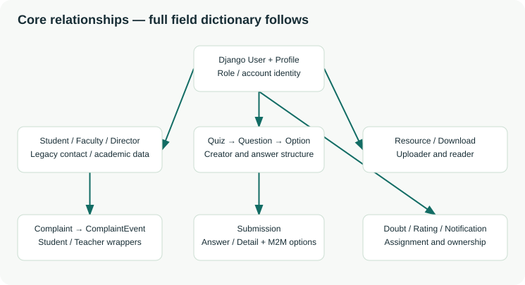

# Database reference

Extracted from Django model metadata on 22 October 2026.

This is the current declared schema. The installed database must also have migrations 0001–0009 applied. Nullable legacy relationships are intentional and do not authorize an arbitrary user to view a historical record.

## Reading the dictionary

FK means foreign key; O2O means one-to-one; M2M means many-to-many. `blank` is form/model-validation behavior, `null` permits SQL NULL, and `PROTECT` prevents deletion while referenced. `CASCADE` removes dependent rows; `SET_NULL` retains the row and clears the link. M2M fields use separate join tables.

Django authentication, groups, permissions, sessions, content types and admin-log tables are provided by installed Django applications. This reference lists every project model and its declared fields, including automatically generated IDs.

## Student

Original student academic record. Its Django user link connects legacy details to current authentication.

Table: `ClassApp_student`. Default ordering: `database default`.

| Field | Type / length | Default | Rules | Relation / deletion | Meaning |
| --- | --- | --- | --- | --- | --- |
| `id` | BigAutoField | — | primary key; null=False; blank=True | — | Automatically generated primary key. |
| `sname` | CharField(100) | — | null=False; blank=False | — | Student full name. |
| `sen` | CharField(50) | — | null=False; blank=False | — | Student enrollment number. |
| `sphone` | CharField(10) | — | null=False; blank=False | — | Student phone text; maximum 10 characters. |
| `semail` | CharField(254) | — | null=False; blank=False | — | Student email address. |
| `unm` | CharField(50) | — | null=False; blank=False | — | Retained legacy username value; current login uses Django User.username. |
| `course` | CharField(50) | '' | null=False; blank=False | — | Student course/department text. |
| `year` | CharField(20) | '' | null=False; blank=False | — | Student academic year text. |
| `sem` | CharField(20) | '' | null=False; blank=False | — | Legacy student semester value. |
| `section` | CharField(5) | '' | null=False; blank=False | — | Student section text. |
| `batch` | CharField(30) | '' | null=False; blank=True | — | Student batch/cohort text, editable at registration and in My profile. |
| `user` | OneToOneField | — | unique; indexed; null=True; blank=True | auth.User; PROTECT | Link to the related record. |

## Faculty

Original faculty contact record; also the assignment target for doubts and feedback.

Table: `ClassApp_faculty`. Default ordering: `database default`.

| Field | Type / length | Default | Rules | Relation / deletion | Meaning |
| --- | --- | --- | --- | --- | --- |
| `id` | BigAutoField | — | primary key; null=False; blank=True | — | Automatically generated primary key. |
| `fname` | CharField(100) | — | null=False; blank=False | — | Faculty full name. |
| `fphone` | CharField(15) | — | null=False; blank=False | — | Faculty phone text; maximum 15 characters. |
| `femail` | CharField(254) | — | unique; null=True; blank=True | — | Faculty email; nullable for retained legacy records. |
| `unm` | CharField(50) | — | unique; null=False; blank=False | — | Retained legacy username value; current login uses Django User.username. |
| `user` | OneToOneField | — | unique; indexed; null=True; blank=True | auth.User; PROTECT | Link to the related record. |

## Director

Original director contact record. Application authorization is determined by Profile.role.

Table: `ClassApp_director`. Default ordering: `database default`.

| Field | Type / length | Default | Rules | Relation / deletion | Meaning |
| --- | --- | --- | --- | --- | --- |
| `id` | BigAutoField | — | primary key; null=False; blank=True | — | Automatically generated primary key. |
| `dname` | CharField(100) | — | null=False; blank=False | — | Director full name. |
| `dphone` | CharField(15) | — | null=False; blank=False | — | Director phone text; maximum 15 characters. |
| `demail` | CharField(254) | — | unique; null=False; blank=False | — | Director email address. |
| `unm` | CharField(50) | — | unique; null=False; blank=False | — | Retained legacy username value; current login uses Django User.username. |
| `user` | OneToOneField | — | unique; indexed; null=True; blank=True | auth.User; PROTECT | Link to the related record. |

## Profile

One profile for every Django user; stores the application role, department and enrollment.

Table: `ClassApp_profile`. Default ordering: `database default`.

| Field | Type / length | Default | Rules | Relation / deletion | Meaning |
| --- | --- | --- | --- | --- | --- |
| `id` | BigAutoField | — | primary key; null=False; blank=True | — | Automatically generated primary key. |
| `user` | OneToOneField | — | unique; indexed; null=False; blank=False | auth.User; CASCADE | Link to the related record. |
| `role` | CharField(10) | Profile.Role.STUDENT | indexed; null=False; blank=False; choices: student, faculty, director | — | student, faculty or director; authorization reads this value. |
| `enrollment` | CharField(90) | — | null=False; blank=True | — | Enrollment metadata; required by student registration forms. |
| `department` | CharField(100) | — | null=False; blank=True | — | Course/department metadata. |

## Contact

Messages submitted through the public TeachTrack contact form. Saving a message does not send an email.

Table: `ClassApp_contact`. Default ordering: `database default`.

| Field | Type / length | Default | Rules | Relation / deletion | Meaning |
| --- | --- | --- | --- | --- | --- |
| `id` | BigAutoField | — | primary key; null=False; blank=True | — | Automatically generated primary key. |
| `name` | CharField(100) | — | null=False; blank=False | — | Name. |
| `email` | CharField(254) | — | null=False; blank=False | — | Email. |
| `title` | CharField(200) | — | null=False; blank=False | — | Title. |
| `message` | TextField | — | null=False; blank=False | — | Message. |
| `created_at` | DateTimeField | Automatic | null=False; blank=True | — | Creation timestamp, set automatically. |

## ImageUploader

Retained historical image model. No current public upload workflow routes to it.

Table: `ClassApp_imageuploader`. Default ordering: `database default`.

| Field | Type / length | Default | Rules | Relation / deletion | Meaning |
| --- | --- | --- | --- | --- | --- |
| `id` | BigAutoField | — | primary key; null=False; blank=True | — | Automatically generated primary key. |
| `photo` | FileField(100) | — | null=False; blank=False | — | Photo. Upload path: ALLImages. |
| `date` | DateTimeField | now() | null=False; blank=False | — | Date. |

## PasswordResetOTP

Retained historical OTP table. Public password reset and outbound email are disabled.

Table: `ClassApp_passwordresetotp`. Default ordering: `database default`.

| Field | Type / length | Default | Rules | Relation / deletion | Meaning |
| --- | --- | --- | --- | --- | --- |
| `id` | BigAutoField | — | primary key; null=False; blank=True | — | Automatically generated primary key. |
| `email` | CharField(254) | — | null=False; blank=False | — | Email. |
| `otp` | CharField(6) | — | null=False; blank=False | — | Historical reset OTP text; no current public OTP/reset workflow. |
| `created_at` | DateTimeField | Automatic | null=False; blank=True | — | Creation timestamp, set automatically. |

## Quiz

Quiz metadata, creator, availability, publication flag and student-detail requirements.

Table: `ClassApp_quiz`. Default ordering: `['-created_at', '-id']`.

| Field | Type / length | Default | Rules | Relation / deletion | Meaning |
| --- | --- | --- | --- | --- | --- |
| `id` | BigAutoField | — | primary key; null=False; blank=True | — | Automatically generated primary key. |
| `title` | CharField(255) | — | null=False; blank=False | — | Title. |
| `created_at` | DateTimeField | Automatic | null=False; blank=True | — | Creation timestamp, set automatically. |
| `expiry_time` | DateTimeField | — | null=False; blank=False | — | Quiz closing timestamp; attempts require current time strictly before this value. |
| `is_active` | BooleanField | True | null=False; blank=False | — | Quiz publication/visibility flag, separate from its time window. |
| `require_name` | BooleanField | False | null=False; blank=False | — | Whether the quiz-attempt name field is mandatory. |
| `require_roll` | BooleanField | False | null=False; blank=False | — | Whether the quiz-attempt roll/enrollment field is mandatory. |
| `require_email` | BooleanField | False | null=False; blank=False | — | Whether the quiz-attempt email field is mandatory. |
| `require_class` | BooleanField | False | null=False; blank=False | — | Whether the quiz-attempt course/class field is mandatory. New quiz forms enable this automatically. |
| `faculty` | ForeignKey | — | indexed; null=True; blank=True | ClassApp.Faculty; CASCADE | Link to the related record. |
| `code` | CharField(6) | — | unique; null=True; blank=True | — | Six uppercase hexadecimal characters, generated when a quiz is saved without a code. |
| `subject` | CharField(100) | — | null=False; blank=True | — | Subject. |
| `starts_at` | DateTimeField | now() | null=False; blank=False | — | Quiz opening timestamp; the opening instant itself is eligible. |
| `creator` | ForeignKey | — | indexed; null=True; blank=True | auth.User; PROTECT | Link to the related record. |

## Question

A quiz question, optional image and single-selection/multiple-selection setting.

Table: `ClassApp_question`. Default ordering: `['id']`.

| Field | Type / length | Default | Rules | Relation / deletion | Meaning |
| --- | --- | --- | --- | --- | --- |
| `id` | BigAutoField | — | primary key; null=False; blank=True | — | Automatically generated primary key. |
| `quiz` | ForeignKey | — | indexed; null=False; blank=False | ClassApp.Quiz; CASCADE | Link to the related record. |
| `text` | TextField | — | null=False; blank=False | — | Text. |
| `image` | FileField(100) | — | null=True; blank=True | — | Image. Upload path: quiz_images/. |
| `is_multiple` | BooleanField | False | null=False; blank=False | — | True enables selection of multiple correct options. |

## Option

An answer option and its correctness flag, attached to one question.

Table: `ClassApp_option`. Default ordering: `['id']`.

| Field | Type / length | Default | Rules | Relation / deletion | Meaning |
| --- | --- | --- | --- | --- | --- |
| `id` | BigAutoField | — | primary key; null=False; blank=True | — | Automatically generated primary key. |
| `question` | ForeignKey | — | indexed; null=False; blank=False | ClassApp.Question; CASCADE | Link to the related record. |
| `text` | CharField(255) | — | null=False; blank=False | — | Text. |
| `is_correct` | BooleanField | False | null=False; blank=False | — | Correct-answer flag; students do not receive it before the review is released. |

## Submission

A recorded quiz attempt with identity and academic snapshots, aggregate score and a saved grading review.

Table: `ClassApp_submission`. Default ordering: `['-score', 'submitted_at', 'id']`.

| Field | Type / length | Default | Rules | Relation / deletion | Meaning |
| --- | --- | --- | --- | --- | --- |
| `id` | BigAutoField | — | primary key; null=False; blank=True | — | Automatically generated primary key. |
| `quiz` | ForeignKey | — | indexed; null=False; blank=False | ClassApp.Quiz; CASCADE | Link to the related record. |
| `submitted_at` | DateTimeField | Automatic | null=False; blank=True | — | Submission timestamp, set automatically. |
| `student_name` | CharField(255) | — | null=True; blank=True | — | Student display-name snapshot, including historical records. |
| `roll_no` | CharField(50) | — | null=True; blank=True | — | Roll/enrollment value copied into an attempt. |
| `email` | CharField(254) | — | null=True; blank=True | — | Email. |
| `class_div` | CharField(50) | — | null=True; blank=True | — | Legacy combined academic summary, limited to 50 characters; full separate values are in academic_details. |
| `score` | IntegerField | 0 | null=False; blank=False | — | Correct-answer count; on SubmissionDetail this is 0 or 1 for one question. |
| `student` | ForeignKey | — | indexed; null=True; blank=True | auth.User; PROTECT | Link to the related record. |
| `total` | PositiveIntegerField | 0 | null=False; blank=False | — | Number of questions in the saved attempt. |
| `review` | JSONField | list() | null=False; blank=False | — | Saved question/option text and selected/correct answer IDs used by the results view. |
| `academic_details` | JSONField | dict() | null=False; blank=True | — | Submission JSON snapshot containing course, year, semester, section and batch separately. |

Declared constraints:

- `one_authenticated_quiz_attempt`: UniqueConstraint — quiz, student.

## SubmissionAnswer

Original per-question answer relationship, including the selected Option many-to-many relation.

Table: `ClassApp_submissionanswer`. Default ordering: `database default`.

| Field | Type / length | Default | Rules | Relation / deletion | Meaning |
| --- | --- | --- | --- | --- | --- |
| `id` | BigAutoField | — | primary key; null=False; blank=True | — | Automatically generated primary key. |
| `submission` | ForeignKey | — | indexed; null=False; blank=False | ClassApp.Submission; CASCADE | Link to the related record. |
| `question` | ForeignKey | — | indexed; null=False; blank=False | ClassApp.Question; CASCADE | Link to the related record. |
| `selected_options` | ManyToManyField | — | null=False; blank=False | ClassApp.Option; M2M via ClassApp_submissionanswer_selected_options | Selected answers, stored through an automatically created join table. |

## SubmissionDetail

Original detailed answer record, retained alongside SubmissionAnswer for historical compatibility.

Table: `ClassApp_submissiondetail`. Default ordering: `database default`.

| Field | Type / length | Default | Rules | Relation / deletion | Meaning |
| --- | --- | --- | --- | --- | --- |
| `id` | BigAutoField | — | primary key; null=False; blank=True | — | Automatically generated primary key. |
| `quiz` | ForeignKey | — | indexed; null=False; blank=False | ClassApp.Quiz; CASCADE | Link to the related record. |
| `submission` | ForeignKey | — | indexed; null=False; blank=False | ClassApp.Submission; CASCADE | Link to the related record. |
| `question` | ForeignKey | — | indexed; null=False; blank=False | ClassApp.Question; CASCADE | Link to the related record. |
| `student_name` | CharField(255) | — | null=True; blank=True | — | Student display-name snapshot, including historical records. |
| `roll_no` | CharField(50) | — | null=True; blank=True | — | Roll/enrollment value copied into an attempt. |
| `email` | CharField(254) | — | null=True; blank=True | — | Email. |
| `class_div` | CharField(50) | — | null=True; blank=True | — | Legacy combined academic summary, limited to 50 characters; full separate values are in academic_details. |
| `score` | IntegerField | 0 | null=False; blank=False | — | Correct-answer count; on SubmissionDetail this is 0 or 1 for one question. |
| `selected_options` | ManyToManyField | — | null=False; blank=False | ClassApp.Option; M2M via ClassApp_submissiondetail_selected_options | Selected answers, stored through an automatically created join table. |

## Doubt

A student question assigned to faculty, with an optional attachment and an editable faculty answer.

Table: `ClassApp_doubt`. Default ordering: `['-submitted_at', '-id']`.

| Field | Type / length | Default | Rules | Relation / deletion | Meaning |
| --- | --- | --- | --- | --- | --- |
| `id` | BigAutoField | — | primary key; null=False; blank=True | — | Automatically generated primary key. |
| `student_name` | CharField(100) | — | null=False; blank=False | — | Student display-name snapshot, including historical records. |
| `student_email` | CharField(254) | — | null=False; blank=False | — | Student email snapshot, including historical records. |
| `doubt` | TextField | — | null=False; blank=False | — | Doubt. |
| `attachment` | FileField(100) | — | null=True; blank=True | — | Attachment. Upload path: attachments/. |
| `faculty` | ForeignKey | — | indexed; null=False; blank=False | ClassApp.Faculty; CASCADE | Link to the related record. |
| `submitted_at` | DateTimeField | Automatic | null=False; blank=True | — | Submission timestamp, set automatically. |
| `student` | ForeignKey | — | indexed; null=True; blank=True | auth.User; PROTECT | Link to the related record. |
| `subject` | CharField(100) | — | null=False; blank=True | — | Subject. |
| `answer` | TextField | — | null=False; blank=True | — | Latest faculty answer text; the form allows an existing answer to be updated. |
| `answered_at` | DateTimeField | — | null=True; blank=True | — | Time of the most recent saved faculty answer. |

## Announcement

A staff-authored update for a selected role or everyone, optionally with a document.

Table: `ClassApp_announcement`. Default ordering: `['-created_at', '-id']`.

| Field | Type / length | Default | Rules | Relation / deletion | Meaning |
| --- | --- | --- | --- | --- | --- |
| `id` | BigAutoField | — | primary key; null=False; blank=True | — | Automatically generated primary key. |
| `title` | CharField(200) | — | null=False; blank=False | — | Title. |
| `content` | TextField | — | null=False; blank=False | — | Content. |
| `posted_by` | ForeignKey | — | indexed; null=True; blank=True | ClassApp.Faculty; SET_NULL | Link to the related record. |
| `document` | FileField(100) | — | null=True; blank=True | — | Document. Upload path: announcements/. |
| `created_at` | DateTimeField | Automatic | null=False; blank=True | — | Creation timestamp, set automatically. |
| `author` | ForeignKey | — | indexed; null=True; blank=True | auth.User; PROTECT | Link to the related record. |
| `audience` | CharField(10) | 'all' | null=False; blank=False; choices: all, student, faculty, director | — | all, student, faculty or director; faculty forms restrict selection to student. |

## Rating

Student feedback about faculty. A student can update their existing rating and comment.

Table: `ClassApp_rating`. Default ordering: `['-updated_at', '-id']`.

| Field | Type / length | Default | Rules | Relation / deletion | Meaning |
| --- | --- | --- | --- | --- | --- |
| `id` | BigAutoField | — | primary key; null=False; blank=True | — | Automatically generated primary key. |
| `student_name` | CharField(100) | — | null=False; blank=False | — | Student display-name snapshot, including historical records. |
| `student_email` | CharField(254) | — | null=False; blank=False | — | Student email snapshot, including historical records. |
| `rating` | PositiveSmallIntegerField | — | null=False; blank=False | — | Integer rating from 1 to 5, with form and database constraints. |
| `faculty` | ForeignKey | — | indexed; null=False; blank=False | ClassApp.Faculty; CASCADE | Link to the related record. |
| `submitted_at` | DateTimeField | Automatic | null=False; blank=True | — | Submission timestamp, set automatically. |
| `student` | ForeignKey | — | indexed; null=True; blank=True | auth.User; CASCADE | Link to the related record. |
| `comment` | TextField | — | null=False; blank=True | — | Comment. |
| `updated_at` | DateTimeField | now() | null=False; blank=False | — | Timestamp updated by the relevant application workflow; it is not auto_now. |

Declared constraints:

- `one_authenticated_faculty_rating`: UniqueConstraint — student, faculty.
- `rating_between_1_and_5`: CheckConstraint — (AND: ('rating__gte', 1), ('rating__lte', 5)).

## AuthenticatedStudent

Original complaint-system student wrapper, linked to a Django user.

Table: `ClassApp_authenticatedstudent`. Default ordering: `database default`.

| Field | Type / length | Default | Rules | Relation / deletion | Meaning |
| --- | --- | --- | --- | --- | --- |
| `id` | BigAutoField | — | primary key; null=False; blank=True | — | Automatically generated primary key. |
| `user` | OneToOneField | — | unique; indexed; null=False; blank=False | auth.User; CASCADE | Link to the related record. |
| `name` | CharField(100) | — | null=False; blank=False | — | Name. |

## Teacher

Original complaint-system faculty wrapper, linked to a Django user.

Table: `ClassApp_teacher`. Default ordering: `database default`.

| Field | Type / length | Default | Rules | Relation / deletion | Meaning |
| --- | --- | --- | --- | --- | --- |
| `id` | BigAutoField | — | primary key; null=False; blank=True | — | Automatically generated primary key. |
| `user` | OneToOneField | — | unique; indexed; null=False; blank=False | auth.User; CASCADE | Link to the related record. |
| `name` | CharField(100) | — | null=False; blank=False | — | Name. |

## Complaint

A student concern assigned to a teacher, with a current status and latest faculty reply.

Table: `ClassApp_complaint`. Default ordering: `['-updated_at', '-id']`.

| Field | Type / length | Default | Rules | Relation / deletion | Meaning |
| --- | --- | --- | --- | --- | --- |
| `id` | BigAutoField | — | primary key; null=False; blank=True | — | Automatically generated primary key. |
| `student` | ForeignKey | — | indexed; null=False; blank=False | ClassApp.AuthenticatedStudent; CASCADE | Link to the related record. |
| `teacher` | ForeignKey | — | indexed; null=False; blank=False | ClassApp.Teacher; CASCADE | Link to the related record. |
| `text` | TextField | — | null=False; blank=False | — | Text. |
| `teacher_reply` | TextField | — | null=True; blank=True | — | Latest faculty reply; full conversation is stored in ComplaintEvent. |
| `status` | CharField(20) | 'pending' | indexed; null=False; blank=False; choices: pending, in_progress, resolved | — | Complaint state: pending, in_progress or resolved. |
| `created_at` | DateTimeField | Automatic | null=False; blank=True | — | Creation timestamp, set automatically. |
| `reply_time` | DateTimeField | — | null=True; blank=True | — | Time of the latest faculty reply. |
| `title` | CharField(180) | 'Student concern' | null=False; blank=False | — | Title. |
| `updated_at` | DateTimeField | now() | null=False; blank=False | — | Timestamp updated by the relevant application workflow; it is not auto_now. |

## ComplaintEvent

Chronological complaint messages and the status recorded for each event.

Table: `ClassApp_complaintevent`. Default ordering: `['created_at', 'id']`.

| Field | Type / length | Default | Rules | Relation / deletion | Meaning |
| --- | --- | --- | --- | --- | --- |
| `id` | BigAutoField | — | primary key; null=False; blank=True | — | Automatically generated primary key. |
| `complaint` | ForeignKey | — | indexed; null=False; blank=False | ClassApp.Complaint; CASCADE | Link to the related record. |
| `author` | ForeignKey | — | indexed; null=False; blank=False | auth.User; PROTECT | Link to the related record. |
| `message` | TextField | — | null=False; blank=False | — | Message. |
| `status` | CharField(20) | — | null=False; blank=False; choices: pending, in_progress, resolved | — | Complaint state: pending, in_progress or resolved. |
| `created_at` | DateTimeField | Automatic | null=False; blank=True | — | Creation timestamp, set automatically. |

## Resource

A private document or picture upload with a built-in/custom category, descriptive metadata and download count.

Table: `ClassApp_resource`. Default ordering: `['-created_at', '-id']`.

| Field | Type / length | Default | Rules | Relation / deletion | Meaning |
| --- | --- | --- | --- | --- | --- |
| `id` | BigAutoField | — | primary key; null=False; blank=True | — | Automatically generated primary key. |
| `title` | CharField(180) | — | null=False; blank=False | — | Title. |
| `description` | TextField | — | null=False; blank=True | — | Description. |
| `subject` | CharField(100) | — | indexed; null=False; blank=False | — | Subject. |
| `category` | CharField(100) | — | indexed; null=False; blank=False | — | Resource category: notes, pyq, assignment or a custom name up to 100 characters. Existing built-in values retain their display labels. |
| `file` | FileField(255) | — | null=False; blank=False | — | File. Upload path: resource_path(). |
| `original_name` | CharField(255) | — | null=False; blank=False | — | Uploaded filename after removing directory components; used for attachment downloads. |
| `uploaded_by` | ForeignKey | — | indexed; null=False; blank=False | auth.User; PROTECT | Link to the related record. |
| `download_count` | PositiveIntegerField | 0 | null=False; blank=False | — | Download-response initiations, including repeats; not proof of completed transfers. |
| `created_at` | DateTimeField | Automatic | null=False; blank=True | — | Creation timestamp, set automatically. |

## Download

An authenticated resource-download initiation. Repeat downloads create additional rows.

Table: `ClassApp_download`. Default ordering: `database default`.

| Field | Type / length | Default | Rules | Relation / deletion | Meaning |
| --- | --- | --- | --- | --- | --- |
| `id` | BigAutoField | — | primary key; null=False; blank=True | — | Automatically generated primary key. |
| `resource` | ForeignKey | — | indexed; null=False; blank=False | ClassApp.Resource; CASCADE | Link to the related record. |
| `user` | ForeignKey | — | indexed; null=False; blank=False | auth.User; CASCADE | Link to the related record. |
| `created_at` | DateTimeField | Automatic | null=False; blank=True | — | Creation timestamp, set automatically. |

## Notification

An individual recipient inbox item. Broadcasts create a separate row for each recipient.

Table: `ClassApp_notification`. Default ordering: `['-created_at', '-id']`.

| Field | Type / length | Default | Rules | Relation / deletion | Meaning |
| --- | --- | --- | --- | --- | --- |
| `id` | BigAutoField | — | primary key; null=False; blank=True | — | Automatically generated primary key. |
| `recipient` | ForeignKey | — | indexed; null=False; blank=False | auth.User; CASCADE | Link to the related record. |
| `title` | CharField(180) | — | null=False; blank=False | — | Title. |
| `message` | TextField | — | null=False; blank=True | — | Message. |
| `link` | CharField(255) | — | null=False; blank=True | — | Optional notification navigation target; the read endpoint only redirects to safe local paths. |
| `read_at` | DateTimeField | — | null=True; blank=True | — | Null until the recipient marks this notification as read. |
| `created_at` | DateTimeField | Automatic | null=False; blank=True | — | Creation timestamp, set automatically. |

Explicit indexes: `ClassApp_no_recipie_b833fa_idx` on `['recipient', 'read_at']`.

## LoginThrottle

Hashed username/IP failure counters for the 15-minute login-attempt window.

Table: `ClassApp_loginthrottle`. Default ordering: `database default`.

| Field | Type / length | Default | Rules | Relation / deletion | Meaning |
| --- | --- | --- | --- | --- | --- |
| `id` | BigAutoField | — | primary key; null=False; blank=True | — | Automatically generated primary key. |
| `key` | CharField(64) | — | unique; null=False; blank=False | — | SHA-256 digest of an ip: or user: throttle key; not a plaintext password. |
| `failures` | PositiveIntegerField | 0 | null=False; blank=False | — | Invalid authentication attempts counted in the current window. |
| `window_start` | DateTimeField | — | null=False; blank=False | — | Beginning of the stored throttle window. |
