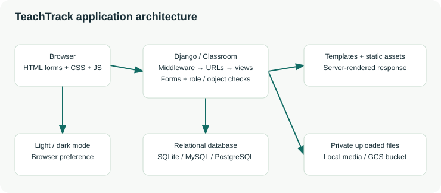
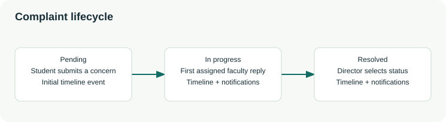

# TeachTrack project handbook


Documentation edition: 22 October 2026. Prepared for Zaman & Saloni. This handbook describes the implementation in this workspace, including quiz option controls and multiple correct answers, Home/WORKSPACE navigation, Campus Life location search, local/private Vercel Blob document and image uploads and custom resource categories.

The project is a server-rendered Django academic workspace. It has one shared campus workspace and three application roles: Student, Faculty and Director. Its source retains the original ClassApp/Classroom layout, academic relationships and migration history while using Django authentication for current accounts.

## Contents

1. [Project overview](PROJECT_DOCUMENTATION.md#1-project-overview)
2. [Architecture and request lifecycle](PROJECT_DOCUMENTATION.md#2-architecture-and-request-lifecycle)
3. [Repository and source responsibilities](PROJECT_DOCUMENTATION.md#3-repository-and-source-responsibilities)
4. [Installation and local startup](PROJECT_DOCUMENTATION.md#4-installation-and-local-startup)
5. [Accounts, roles and permissions](PROJECT_DOCUMENTATION.md#5-accounts-roles-and-permissions)
6. [Page-by-page user guide](PROJECT_DOCUMENTATION.md#6-page-by-page-user-guide)
7. [Academic workflow rules](PROJECT_DOCUMENTATION.md#7-academic-workflow-rules)
8. [Database and migration design](PROJECT_DOCUMENTATION.md#8-database-and-migration-design)
9. [Forms and validation](PROJECT_DOCUMENTATION.md#9-forms-and-validation)
10. [URLs and request contracts](PROJECT_DOCUMENTATION.md#10-urls-and-request-contracts)
11. [Design, colours and front-end behavior](PROJECT_DOCUMENTATION.md#11-design-colours-and-front-end-behavior)
12. [Authentication, security and private files](PROJECT_DOCUMENTATION.md#12-authentication-security-and-private-files)
13. [Configuration and dependencies](PROJECT_DOCUMENTATION.md#13-configuration-and-dependencies)
14. [Management commands](PROJECT_DOCUMENTATION.md#14-management-commands)
15. [Testing and acceptance](PROJECT_DOCUMENTATION.md#15-testing-and-acceptance)
16. [Deployment, maintenance and recovery](PROJECT_DOCUMENTATION.md#16-deployment-maintenance-and-recovery)
17. [Troubleshooting](PROJECT_DOCUMENTATION.md#17-troubleshooting)
18. [Scope, limitations and extension guide](PROJECT_DOCUMENTATION.md#18-scope-limitations-and-extension-guide)
19. [Glossary](PROJECT_DOCUMENTATION.md#19-glossary)

The accompanying references provide every project model field, form field, route and explicit active-stylesheet colour: [Database reference](DATABASE_REFERENCE.md), [Forms reference](FORM_REFERENCE.md), [Route reference](ROUTE_REFERENCE.md), [Configuration reference](CONFIGURATION_REFERENCE.md), [Design system](DESIGN_SYSTEM.md), [Colour index](COLOUR_INDEX.md) and [Test catalogue](TEST_CATALOGUE.md).

## 1. Project overview

### Purpose

TeachTrack provides a central place for learning resources, quizzes, announcements, student questions, faculty feedback and complaint tracking. It replaces scattered academic exchanges with authenticated workflows whose permissions are checked by the server.

Students use the platform to find materials, attempt quizzes, ask doubts, send feedback and follow concerns. Faculty publish materials and quizzes, answer their assigned doubts and respond to assigned complaints. Directors manage campus access, review aggregate information, manage complaint status and export reports.

### Functional scope

| Module | Main capability | Principal records |
| --- | --- | --- |
| Public website | Homepage, campus information and contact form | Static images; Contact |
| Identity | Username/password login, role labels, signed-in password change | Django User, Profile, LoginThrottle |
| Accounts | Director-created student/faculty/director accounts; deactivation | User, Profile and legacy role records |
| Resources | Documents/images, built-in/custom categories, search, filters and downloads | Resource, Download |
| Quizzes | Timed availability, 2–26 options per question, exact-set scoring and review | Quiz, Question, Option, Submission |
| Announcements | Role-targeted campus posts and optional documents | Announcement |
| Notifications | Individual inbox, broadcasts and workflow messages | Notification |
| Doubts | Student-to-faculty questions and answers | Doubt |
| Feedback | One editable student rating/comment per faculty member | Rating |
| Complaints | Assigned concern, conversation, status and timeline | Complaint, ComplaintEvent |
| Reporting | Staff charts and director CSV exports | Queries over academic records |

### Implementation snapshot

| Area | Current implementation |
| --- | --- |
| Framework | Django 5.2.18, as pinned in requirements.txt |
| Rendering | Django templates and ordinary HTML form submissions |
| Browser code | Project CSS and vanilla JavaScript; no front-end build step |
| Data access | Django ORM; database selected by DATABASE_URL |
| Local fallback database | db.sqlite3 only when DATABASE_URL is blank |
| Database options | SQLite for local work; PostgreSQL or MySQL Connector |
| Uploaded files | Configurable auto/local/gcs/disabled storage, independently of the database |
| Static assets | Django staticfiles plus WhiteNoise compressed manifest storage |
| Production process | Vercel Django deployment or Gunicorn serving Classroom.wsgi:application in the container |
| Timezone | Asia/Kolkata; timezone-aware application timestamps |
| Tests | Workflow, migration, database/environment and storage checks listed in TEST_CATALOGUE.md |

The source contains cloud configuration and a deployment guide. A working local server and passing local tests do not establish that a live deployment or private production bucket has been provisioned.

## 2. Architecture and request lifecycle



### Application layers

| Layer | Responsibility | Source |
| --- | --- | --- |
| Browser | Displays pages; submits CSRF-protected forms; runs menu/carousel/question-builder controls | Templates; app.css; app.js |
| Project configuration | Loads environment settings, middleware, installed apps and root routes | Classroom/settings.py; Classroom/urls.py |
| Routing | Maps public, academic and compatibility paths to view functions | ClassApp/urls.py |
| Authorization | Requires login, verifies roles and restricts object querysets | permissions.py; view checks |
| Form validation | Checks field values, account details, choices, file content and quiz structure | forms.py |
| Workflow logic | Coordinates queries, transactions, grading, notifications and responses | views.py |
| Shared services | Creates notifications and links current users with legacy records | services.py |
| Persistence | Describes records, constraints, indexes and relationships | models.py; migrations/ |
| Presentation context | Supplies role and unread-notification count to authenticated templates | context_processors.py |

### Example: uploading a resource

1. An authenticated faculty member opens the upload form.
2. The role decorator admits faculty and directors; students cannot access the action by entering its URL directly.
3. The browser submits the form and file with a CSRF token.
4. Request-size middleware rejects a declared body above 32 MiB. Form validation checks the file itself against the 30 MiB policy and its permitted document/image content format.
5. The view starts a database transaction, assigns the current user as uploader, strips directory components from the original filename and saves the resource.
6. Django storage writes the file under a generated resource key. Student recipients receive individual notification records.
7. A success message is added and the browser is redirected to the resource list.

Database transactions protect related database changes. They do not create a distributed transaction spanning SQL and an external object-storage write; an interrupted workflow can require orphan-file review.

### Middleware sequence

The configured order is SecurityMiddleware, WhiteNoise, SessionMiddleware, CommonMiddleware, RequestSizeLimitMiddleware, CsrfViewMiddleware, AuthenticationMiddleware, MessageMiddleware and XFrameOptionsMiddleware. Ordering is significant: declared oversized bodies are checked before CSRF processing, and the custom middleware can add private/no-store headers after authenticated responses return.

There is no task queue, websocket consumer, public JSON API, service worker or separate JavaScript application in the current implementation. Notifications are created synchronously and their unread count refreshes on page navigation.

## 3. Repository and source responsibilities

```text
TeachTrack/
  manage.py                         Django command entry point
  requirements.txt                 Main pinned dependency set
  requirements-mysql.txt           Compatibility include of the main requirements
  Dockerfile                       Python 3.12 / Gunicorn container
  .env.example                     Safe configuration template
  Classroom/
    settings.py                    Environment, database, storage and security
    urls.py                        Admin and account/password routes
    wsgi.py                        WSGI application entry point
    asgi.py                        ASGI application entry point
  ClassApp/
    models.py                      24 project models
    forms.py                       User-input and upload validation
    views.py                       Academic and public workflows
    urls.py                        Primary paths and original aliases
    permissions.py                 Login + allowed-role decorator
    services.py                    Notification and legacy-link helpers
    signals.py                     Profile creation when a User is created
    context_processors.py          Role and unread inbox count
    middleware.py                  Body-size and authenticated-cache controls
    admin.py                       Trusted Django admin registration
    apps.py                        App registration and signal loading
    tests.py                       Workspace and migration test classes
    test_database_config.py         Database/environment configuration tests
    test_upload_storage.py          Upload storage selection tests
    management/commands/           Director, demo, report and import commands
    migrations/                    Original 0001–0006 and upgrade 0007–0011
    Templates/                     Active and retained legacy templates
    static/ClassApp/app.css        Current visual system
    static/ClassApp/app.js         Current browser interactions
    static/img/                    Campus photographs and other source images
    static/css/, js/, fonts/       Retained original theme assets
  docs/                            Handbook, references and operational guides
  tools/build_documentation.py     Regenerates references and offline HTML
  media/                           Local uploaded files, when local storage is used
  staticfiles/                     Generated collectstatic output
  .venv/                           Local Python environment
```

### Source files versus generated/local files

Edit source images and styles under ClassApp/static/. Run collectstatic to produce staticfiles/ and its hash-named copies. Editing a generated file such as staticfiles/img/Slider-img1.<hash>.jpg is not a durable source change.

The environment file, generated development secret, local database, uploaded media, generated static output and logs are excluded by the project’s ignore rules. Documentation contains example configuration values, not the contents of the private .env or stored account credentials.

### Active template families

| Family | Templates and behavior |
| --- | --- |
| Application shell | base.html; authenticated sidebar/topbar/footer, or anonymous authentication layout |
| Public shell | public_base.html overrides the page_layout block; shared public header/footer |
| Public pages | index.html; campus_life.html; contact.html |
| Current sign-in | registration/login.html with the optional role label and role links |
| Generic forms | form.html for registration, uploads and several action forms |
| Account administration | accounts.html and account_form.html |
| Overview and resources | dashboard.html and resources.html |
| Quizzes | quizzes.html; quiz_create.html; quiz_attempt.html; quiz_result.html; leaderboard.html |
| Communication | announcements.html; notifications.html; doubts.html; feedback.html |
| Complaints | complaints.html and complaint_detail.html |
| Reporting/history | reports.html and submission_history.html |
| Shared partials | pagination.html; signed-in password-change completion template |
| Error presentation | 403.html, 404.html, 500.html; actual error presentation also depends on DEBUG |

Files such as faculty_login.html, director_login.html, student_dashboard.html, Director_dashboard.html and the old quiz/ templates remain in the repository for historical context. Their presence does not mean a current URL renders them. The original role URLs now use the upgraded views and current templates. For example, /faculty-login/ renders registration/login.html with a faculty role context, and /faculty_dashboard/ renders dashboard.html after its role check.

### Shared helper functions

| Helper | Purpose |
| --- | --- |
| paginated | Creates a 15-record Paginator page and tolerates invalid page selection through get_page |
| form_page | Renders a form using form.html and a supplied page title |
| display_name | Uses full name when available, otherwise username |
| visible_complaints | Builds the student-own, faculty-assigned or director-all complaint queryset |
| valid_quiz | Requires questions, at least two options each, at least one correct option, and exactly one correct option for single-selection questions |
| csv_value | Converts values to text and prefixes suspicious spreadsheet-formula starts with an apostrophe |
| notify | Deduplicates recipient IDs and bulk-creates notifications in batches of 500 |
| audience_users | Selects active users, optionally restricted to one application role |
| ensure_legacy | Ensures the role record and original complaint wrappers exist for a current User |
| create_profile signal | Creates a Profile for each new User; superusers start as directors and other users as students |

### Trusted administration

admin.py registers 22 project models with Django’s admin site, alongside Django’s own User/Group administration. ProfileAdmin provides role/department filters and username/name/enrollment search. StudentAdmin displays academic fields, offers name/enrollment/email search and makes the User link read-only. FacultyAdmin and DirectorAdmin display contact/identity information and also make the User link read-only. The remaining registered project models use the default admin interface.

LoginThrottle and the historical PasswordResetOTP model are not registered by this admin.py. The site header is TeachTrack administration and its browser title is TeachTrack. This trusted interface can expose more underlying record data than the role-filtered product screens; its Django staff/permission requirements must be managed separately from Profile.role.

## 4. Installation and local startup

### Choose the correct starting point

| Situation | Correct action |
| --- | --- |
| This existing working workspace | Keep the current .env and virtual environment; use the short startup commands below |
| Fresh source checkout with no data | Create a virtual environment and .env, select a new database, then migrate |
| Existing consistent populated database | Read UPGRADE.md and rehearse against a backup before applying migrations |
| Historical incomplete bundled SQLite file | Do not fake migrations; use a clean database or the supported read-only importer after review |

The Dockerfile’s baseline is Python 3.12. The existing Windows workspace has also been exercised with Python 3.14.5 and Django 5.2.18. Keep interpreter and installed packages together; the direct .venv interpreter path avoids PowerShell activation-policy problems.

### Start this existing Windows workspace

Run from the directory containing manage.py:

```powershell
$env:DEBUG = 'True'
.\.venv\Scripts\python.exe manage.py check
.\.venv\Scripts\python.exe manage.py runserver
```

Open http://127.0.0.1:8000/. Local runserver loads the selected TEACHTRACK_ENV_FILE (default .env) with override enabled. Other commands and deployed entry points preserve existing process environment values. Keep the selected private file configured for the intended local database.

### Isolated PC MySQL startup from CMD

Set `.env.local-mysql` to use the MySQL server on your PC, with a DATABASE_URL host of `127.0.0.1`, your URL-encoded credentials and local database name. Set `DEBUG=True`, `MYSQL_SSL_MODE=DISABLED` and `UPLOAD_STORAGE=local` in that private file. Then run in Command Prompt:

```cmd
cd /d "C:\Users\Zamanuddin Khan\Downloads\Coding Area\TeachTrack"
set "TEACHTRACK_ENV_FILE=.env.local-mysql"
set "DATABASE_URL="
.venv\Scripts\python.exe manage.py migrate
.venv\Scripts\python.exe manage.py runserver 127.0.0.1:8001
```

Open http://127.0.0.1:8001/. Migrate uses the selected local database; it does not transfer production data. Local resource uploads go to media/ and retain a private database file copy after migration 0012. Confirm other inherited database/storage settings do not override your chosen file when running management commands; see [database setup](DATABASE_SETUP.md).

### Fresh Windows setup

Use an installed Python matching the chosen baseline. These commands assume Python 3.12 is installed and the source directory does not already contain a working environment:

```powershell
py -3.12 -m venv .venv
.\.venv\Scripts\python.exe -m pip install -r requirements.txt
if (-not (Test-Path -LiteralPath '.env')) { Copy-Item .env.example .env }
$env:DEBUG = 'True'
.\.venv\Scripts\python.exe manage.py check
.\.venv\Scripts\python.exe manage.py migrate
.\.venv\Scripts\python.exe manage.py create_director --username director --email director@example.com --name "Campus Director"
.\.venv\Scripts\python.exe manage.py runserver
```

Before migrate, confirm DATABASE_URL selects the intended new database. If it is blank, Django uses the project’s db.sqlite3 path; an existing file at that path is not automatically replaced or cleaned.

### Linux/macOS equivalent

```bash
python3.12 -m venv .venv
.venv/bin/python -m pip install -r requirements.txt
test -f .env || cp .env.example .env
export DEBUG=True
.venv/bin/python manage.py check
.venv/bin/python manage.py migrate
.venv/bin/python manage.py create_director --username director --email director@example.com --name "Campus Director"
.venv/bin/python manage.py runserver
```

### Database choices

DATABASE_URL is parsed by dj-database-url. Local SQLite is the fallback when blank; production requires PostgreSQL or MySQL. The main dependency set includes psycopg and mysql-connector-python. requirements-mysql.txt includes the same base set for compatibility.

For MySQL, settings remap django.db.backends.mysql to mysql.connector.django and default to certificate/hostname verification with certs/aiven-ca.pem. MYSQL_SSL_MODE, MYSQL_SSL_CA and optional client certificate/key variables customize TLS; trusted local MySQL can use DISABLED. See DATABASE_SETUP.md for full configuration. Use the actual Aiven host, port, database name and URL-encoded credentials; keep credentials private. Schema migrations do not transfer data between engines.

### First account and first useful session

The create_director command prompts privately for the password twice. There is no bundled default password. Sign in with the username chosen for that account. Use Manage accounts to create a faculty user, then add a student through public registration or the director account form. Uploaded resources and faculty choices become meaningful once those accounts exist.

Running createsuperuser is a separate decision for trusted Django administration. A normal director account is an application account and is not automatically a Django staff or superuser account.

## 5. Accounts, roles and permissions

### Identity model

Django User stores the username, password hash, name, email and is_active status. Profile stores the application role. Original Student, Faculty and Director records retain descriptive/contact data and connect to the Django user. Faculty and student complaint workflows also use the original Teacher and AuthenticatedStudent wrappers.

Passwords are checked through Django AuthenticationForm. The older role-table username/password approach and custom session keys do not establish current identity. Plaintext pw columns were removed by migration 0009.

### Own profile editing

Every role opens /accounts/profile/ from the sidebar name/role footer. Name, username, email, department and phone are editable for the current account; students additionally edit enrollment, year, semester, section and batch. Saving synchronizes linked role records and complaint-wrapper names. Role, account IDs and permission flags cannot be edited here. Duplicate usernames/emails fail validation.

### Role-specific login

| Page | Behavior |
| --- | --- |
| /accounts/login/ | Shared username/password sign-in; workspace follows the account’s role |
| /student-login/ | Student-labeled sign-in; a valid account with another role receives guidance to use its own role page |
| /faculty-login/ | Faculty-labeled sign-in; explains that a director creates faculty accounts |
| /director-login/ | Director-labeled sign-in; explains existing-director account administration |

Choosing a role link changes the sign-in context; it does not grant that role. Correct credentials on an incorrect role page do not count as an invalid-password attempt. An already-authenticated user who opens a login page is redirected to their dashboard.

### Account-form differences

| Input | Student | Faculty | Director |
| --- | --- | --- | --- |
| Username, full name and email | Required | Required | Required |
| Password and confirmation | Required | Required | Required |
| Course/department | Required; Course / department label | Required; Department label | Required; Department label |
| Enrollment | Required | Absent | Absent |
| Phone | Optional, maximum 10 characters | Optional, maximum 15 characters | Optional, maximum 15 characters |
| Year, semester and section | Optional | Absent | Absent |
| Who can create the account | Public student registration or a director | Director | Bootstrap command or existing director |

Manage accounts → Create account defaults to Faculty. Role links select the form before data entry. The original faculty-registration and director-registration routes fix their intended role on the server, even if a submitted role value is different. Staff creation discards student-only form fields instead of saving inappropriate enrollment/year/semester data.

### Permission matrix

| Action | Student | Faculty | Director |
| --- | --- | --- | --- |
| Public homepage and campus information | Yes | Yes | Yes |
| Search/download resources | Yes | Yes | Yes |
| Upload a resource | No | Yes | Yes |
| Create/publish a quiz | No | Own quizzes | All quizzes |
| Attempt a quiz | Own single attempt | No | No |
| Review submissions/history | Own | Quizzes created by the faculty user | All |
| View leaderboard | Published quiz or previously attempted unpublished quiz | Own quizzes | All |
| Create a doubt | Yes | No | No |
| View doubts | Own | Assigned | All |
| Answer a doubt | No | Assigned only | No answer action |
| Submit/edit feedback | Own | No | No |
| View feedback comments | Own | Received | All |
| Post announcements or broadcasts | No | Students audience only | Any configured audience |
| Create a complaint | Yes | No | No |
| View/reply to complaints | Own | Assigned | All |
| Select complaint status | No | First pending reply starts progress automatically | Yes |
| Create/deactivate users | No | No | Yes, with director/superuser protections |
| Export reports | No | No | Yes |
| Use Django admin | Only if separately granted Django admin permissions | Same | Same |

Feedback templates hide student identity from the displayed comments, but the underlying records retain student names/email/user links. This is presentation-level identity hiding, not irreversible anonymization of the stored data.

### Deactivation and role maintenance

The director’s toggle action changes User.is_active. It protects the requesting user, director accounts and superusers from deactivation through that page. Inactive users cannot log in through the standard backend, and existing sessions no longer authenticate as an active user on subsequent requests.

There is no user-facing role-editing or profile-editing workflow in this version. A trusted administrator who modifies roles directly must keep the legacy role records and complaint wrappers consistent; changing one Profile field alone is not a complete role-migration procedure.

## 6. Page-by-page user guide

### Public homepage

The header offers Home, Features, Campus life, Contact and account access. The TeachTrack logo opens Home for anonymous and signed-in users. The main Home view hides the signed-in WORKSPACE header button; its hero still offers a workspace action. Features is `/#features` on the same page, where the header WORKSPACE button becomes visible and opens the dashboard. Signed-in users also see WORKSPACE on Campus life and Contact. Anonymous visitors see Sign in/Get started. Seven campus photos appear in a manual carousel with previous/next arrows, individual dots and a current-photo counter. The removed star/tagline block is absent.

The three feature cards introduce the resource library, quizzes/feedback and campus communication. The footer contains campus identity, public navigation, role-specific sign-in links, student registration, credits and Back to top.

### Campus Life

Campus life opens /campus-life/, rather than scrolling to the homepage photograph. The page displays the user-selected campus cover image, SAIT logo, library and Common Ground café, four facility summaries, an eight-photo gallery, campus location and official contact links. With the cover/logo, facility images and location image, the page contains 13 image elements.

Campus descriptions stay inside TeachTrack and do not link to Aurobindo's official website. The Find us in Indore panel includes View location on Google Maps, opening a new-tab search for Sri Aurobindo Institute of Technology, Indore, Madhya Pradesh. This is a place search, not a pinned coordinate or verified directions route. Telephone and email links remain. Image references and historical information sources are recorded in CAMPUS_CONTENT.md. Google thumbnail references were downloaded into project static assets so local rendering does not depend on third-party image requests.

### Dashboard

Student cards count available quizzes, the student’s submissions, all resources and their open complaints. Faculty cards count their quizzes, submissions to their quizzes, their resource uploads and assigned open complaints. Director cards count active students, active faculty, all resources and all open complaints.

Recent resources and audience-relevant announcements are shown to all signed-in users. Staff receive participation and feedback charts; students do not see those staff chart panels. Complaint status totals use each role’s visible complaint queryset. The old Teacher Performance and Student Performance sections are not present.

### Resources

Use search, category, subject and sorting controls to locate a file. Upload buttons are shown to staff and are also protected by server checks. A Download form sends POST and returns an attachment response. Download counts increase when that authenticated response is initiated.

### Quizzes and submission history

Students see published quizzes, including those that may be upcoming or already closed; the attempt action performs the opening/closing check. Faculty see their own quizzes; directors see all. A six-character code filters the listing by an exact code. A student with an existing attempt is sent to the result rather than receiving another attempt.

Submission history shows only the student’s records, records for a faculty member’s own quizzes, or all records for a director. The leaderboard orders verified-student attempts by descending score, earlier submission time and ID; it uses sequential row positions rather than shared numerical ranks for equal scores.

### Announcements and notifications

Announcements are shared posts filtered by audience, with an author exception that permits seeing one’s own posts. Notifications are separate recipient-specific inbox records. Marking one read can navigate to a validated local link; marking all read affects only the current user’s unread items.

### Doubts

A student chooses an active faculty member, supplies a question and may add a validated attachment. The assigned faculty member can answer or update an answer. A director can inspect the records but does not receive the faculty answer action.

### Faculty feedback

A student selects active faculty, chooses a rating from 1 to 5 and may add a comment. Submitting again updates the existing student/faculty feedback pair. The overview shows averages and response counts; faculty comments and aggregates are restricted to the receiving faculty user, while directors see the broader set.

### Complaints

A student chooses the responsible faculty member and enters a title and concern. The detail view displays the conversation in chronological order. Students and assigned faculty can reply; directors additionally receive a status selector. The list can be filtered by the stored status code.

### Reports and account administration

Directors can create accounts, deactivate eligible non-director users and download four report families. Accounts are listed by first name then username. Reports summarize data already in the system; they do not perform cohort enrollment, payroll, attendance or gradebook management.

### Contact

The public Contact page uses public_base.html, retaining the homepage header, footer, active navigation and theme toggle. Valid submissions create Contact records and redirect home with a success message. Authorized Django administrators can inspect them at /admin/; they do not appear in the role dashboards and do not send email.

## 7. Academic workflow rules

### Resource upload and download

Resources have a title, optional description, subject, category, file, safe original filename, uploader, count and timestamp. Built-in categories are notes, pyq and assignment. Faculty/directors can choose + Add custom category and enter a name of up to 100 characters. Successful uploads save the category on the resource; saved values are reused in later upload choices and library filters. Whitespace is collapsed, and a case-insensitive match against an existing category value or label reuses that category. There is no separate category-management table or deletion screen. New resource uploads notify active students. Uploaded resource keys use a random UUID and the lowercased file extension under resources/.

The resource form accepts PDF, UTF-8 TXT, DOCX, PPTX, JPG/JPEG and PNG, with recognizable content validation. A file may be up to 30 MiB (labelled 30 MB in the interface), within the combined 32 MiB request limit. Local storage works without Google Cloud: UPLOAD_STORAGE=local saves bytes under media/ and a private ResourceFile database copy, in addition to resource details.

Search matches title, description or subject. Category filters use the stored code; subject uses a case-insensitive exact match. The title sort orders title then ID; the default is newest creation time then ID. Lists use 15 records per page.

The download view first opens the configured file. If it is missing, a ResourceFile copy with the same current file key is used. If both are unavailable, the view returns 404 before incrementing its count. The backup is stored separately, so list queries do not load binary content. Successful initiation creates a Download row and increments Resource.download_count with a database F expression. Repeat downloads count again; the system does not measure whether the client completed the entire transfer.

### Building a quiz

1. Faculty or director enters title, subject, launch time and submission deadline, displayed in IST.
2. New QuizForm instances publish automatically and require name, enrollment, email and course. The five old checkbox settings are not displayed; authorized staff can still use the publication toggle later.
3. Add between 1 and 50 questions, with optional images and single/multiple selection.
4. Each question starts with four options. Use Add option/Remove last option for 2–26 options (A–Z); every visible option needs text. Removing the last option clears it from the selected correct answers. Tick exactly one correct answer for single-choice or a nonempty set for multiple-choice. Selecting more than one correct answer automatically enables Allow multiple correct options; turning that setting off retains only the first selected answer.
5. A transaction saves the quiz/questions/options and notifies active students.

Quiz question numbers sit inside each card above the question text. Question panels align with student details and long options wrap. The multipart form supports optional images when uploads are enabled. Quiz codes use secrets.token_hex(3).upper(); a uniqueness failure is reported rather than silently retried.

### Availability and attempt eligibility

The eligibility condition is published and starts_at <= now < expiry_time. Equality with the opening time permits an attempt; equality with the closing time does not. An unpublished quiz cannot be newly attempted. A quiz also needs at least one valid question with at least two options per question and an appropriate correct-answer set.

The date widgets use local datetime input labels in IST. Django stores timezone-aware values and renders them using Asia/Kolkata. There is no separate browser countdown or per-student duration setting.

### Attempt processing and scoring

The view locks the Quiz row inside a transaction, checks for an existing authenticated attempt, verifies availability and validates the quiz structure. Initial student details come from the authenticated account and linked student record. Course, year, semester, section and batch are separate prefilled inputs; submissions retain these values in academic_details JSON. The legacy class_div summary remains for compatibility. Empty optional values are filled from those initial details when saving.

Every question must have a non-empty answer selection. Selected IDs must belong to that question, may not repeat and must have exactly one element for single-selection questions. Forged option IDs from another question are rejected.

```text
correct_for_question = sorted(all correct Option IDs)
selected_for_question = sorted(submitted Option IDs)
question_score = 1 if selected_for_question == correct_for_question else 0
submission_score = sum(question_score for every question)
submission_total = number of questions
percentage = round(score * 100 / total), or 0 when total is 0
```

Multiple-selection questions use exact-set scoring, with no partial marks. Selecting one correct option while omitting another is incorrect; selecting an extra incorrect option is also incorrect. There is no negative marking or configurable question weighting.

Saving an attempt writes Submission, a grading review JSON snapshot, a SubmissionAnswer row for each question and a SubmissionDetail row for each question. Both original answer models retain their selected-option M2M links. A database uniqueness constraint protects the quiz/student pair, supplementing the transaction check. A duplicate write is treated as an already-recorded submission.

### Results, review and leaderboard

Students see their own saved score immediately. The template releases selected/correct answer review to students only once the quiz closes. Staff who are authorized for that quiz can review its answers earlier. Result views do not publicly expose the grading snapshot as a JSON endpoint.

A faculty member cannot inspect another faculty creator’s results. Directors can inspect all. Student leaderboards omit historical rows without a verified student link. A published quiz’s leaderboard is accessible to students; an unpublished quiz also requires that the student previously attempted it. These checks do not make the quiz code a secret authorization token.

### Complaint lifecycle



| Event | Status behavior | Records/recipients |
| --- | --- | --- |
| Student creates concern | pending | Complaint plus initial ComplaintEvent; assigned faculty and active directors are notified |
| Assigned faculty first replies while pending | in_progress | Latest teacher_reply/reply_time plus a new event; participants/directors except actor are notified |
| Student replies | Preserves current status | Adds conversation event and notifications |
| Faculty replies after progress/resolution | Preserves current status | Updates latest faculty reply and adds event |
| Director replies/selects a status | Uses selected status, or current value when blank | Adds event and participant notifications |

The UI’s intended sequence is pending → in_progress → resolved. The director selector accepts any configured status, so reopening or moving back is technically allowed; the implementation does not enforce a one-way state machine. Directors must provide a reply message when submitting the form, even when their purpose is to change status.

### Doubts and feedback

A doubt stores the authenticated student link and name/email snapshots, selected Faculty, subject, text, optional attachment and latest answer/timestamp. The assigned faculty user receives the new-doubt notification. An answer notifies the verified student when that link exists.

Feedback uses update_or_create on student/faculty. Uniqueness and the 1–5 range are enforced by database constraints as well as the form. Student identity hiding applies to the rendered feedback view. Historical duplicate/unlinked rows may remain in the database and affect staff aggregates.

### Broadcasts and event notifications

Faculty can send announcements and direct inbox broadcasts to Students. Directors may target Everyone, Students, Faculty or Directors. Audience recipients are active users. Announcement content creates a notification whose message is truncated to the first 250 characters; a direct broadcast uses its entered message.

Workflow events include student welcome, new resources, quiz creation/publication/submission, new doubts/answers and complaint creation/updates. The notify helper deduplicates recipients before bulk insertion. Notifications do not send email, browser push or SMS.

### Analytics and CSV exports

| Report kind | Columns | Order |
| --- | --- | --- |
| feedback | Faculty, Average rating, Responses | Faculty name, ID |
| quizzes | Quiz, Code, Faculty, Submissions, Active students, Participation % | Quiz title, ID |
| complaints | Title, Student, Faculty, Status, Created at | Complaint title, ID |
| resources | Title, Subject, Category, Downloads, Uploader | Resource title, ID |

The CSV response uses UTF-8 with a BOM, an attachment filename and private/no-store headers. Cells beginning with a spreadsheet formula marker after leading whitespace, or starting with tab/newline/carriage return, are prefixed with an apostrophe. This helps prevent ordinary exported cell values from being interpreted as formulas.

Participation uses submissions divided by the current active student count, not class enrollment at the time of publication. Dashboard percentages are rounded to whole numbers and capped at 100; CSV participation uses two decimal places and is not capped. Feedback report averages use two decimal places; the displayed feedback overview uses one. An empty denominator gives zero participation.

## 8. Database and migration design

The [complete data dictionary](DATABASE_REFERENCE.md) lists all 24 project models, all declared fields, lengths, defaults, blank/null behavior, relations, deletion rules, choices, constraints and explicit indexes.

### Core relationships

User has one Profile and can connect to a Student, Faculty or Director record. Faculty are referenced by doubts, ratings and historical quizzes. Quiz contains Questions; each Question contains Options. A Submission references its Quiz and verified student User, and owns the original answer/detail rows with their selected Options.

Complaints retain the original AuthenticatedStudent and Teacher relationships. ComplaintEvent provides the conversation timeline. Resource references an uploader; Download references its resource and downloading user. Notification belongs to one recipient. Announcement has an author and a role audience.

### Constraints and indexes

| Rule | Purpose |
| --- | --- |
| Unique quiz code | Prevents two saved quizzes using the same generated lookup code |
| one_authenticated_quiz_attempt | At most one linked Submission for a quiz/student pair |
| one_authenticated_faculty_rating | At most one linked Rating for a student/faculty pair |
| rating_between_1_and_5 | Database range check for faculty rating |
| Profile.role index | Supports role filters and recipient selection |
| Resource subject/category indexes | Supports library filtering |
| Complaint.status index | Supports status filtering |
| Notification recipient/read_at index | Supports unread count and recipient inbox queries |

Null links retained for historical compatibility may allow multiple unlinked legacy records. They should not be read as verified authenticated student attempts or feedback ownership.

### Migration history

Migrations 0001–0006 represent the original model history. Migration 0007 adds the secure academic fields and new modules. Migration 0008 converts accounts, hashes old passwords, assigns roles, links unambiguous records, fills quiz metadata/reviews and clears old sessions/OTPs. Migration 0009 removes plaintext password columns and adds uniqueness/rating constraints. Migration 0010 adds Student.batch and Submission.academic_details without guessing historical snapshots. Migration 0011_resource_custom_category widens the indexed Resource.category field to 100 characters and removes its fixed model choices while retaining existing values; built-in and saved custom choices are supplied by the form and library view.

The conversion is intentionally irreversible. A rollback to an older schema requires restoring the matching backed-up database and application code, rather than unapplying the password-removal migration. Existing media paths and record IDs are retained by the intended upgrade path.

### Historical ambiguity

Username conflicts do not silently take over an existing Django account. The migration can assign a unique conflict-safe username. The mapping command reports the resulting login names without passwords. Ambiguous email/enrollment matches remain unlinked instead of being assigned to an arbitrary student.

When repeated historical attempts/ratings map to the same authenticated pair, only the newest receives that link; older rows remain as historical data. This is why historical totals may differ from a clean new database. See UPGRADE.md for the detailed rehearsal and conflict-handling procedure.

## 9. Forms and validation

The [forms reference](FORM_REFERENCE.md) lists every active form field, required flag, widget, choice and directly declared bound. AccountForm is listed separately for all three roles because the field sets differ.

The reference also includes the installed Django AuthenticationForm and PasswordChangeForm, plus three unsaved ProfileForm variants used by the current account/password workflows. Those forms are inspected with an unsaved dummy User, without loading any real account.

Browser attributes improve entry but do not replace server checks. The role decorator runs independently of whether a button is visible. ModelChoice faculty fields constrain the submitted target to active faculty users. The quiz-attempt view checks option ownership rather than trusting the radio/checkbox values emitted earlier.

The generic form template renders Django field errors and help text. For forms that accept files, POST must use multipart/form-data. The quiz builder also submits the management form for the questions formset; adding DOM fields without updating TOTAL_FORMS would not create a valid extra question.

Phone fields are strings with length bounds. Year and semester are descriptive text, not a validated academic calendar or cohort assignment. Email-uniqueness checks in forms should not be confused with a global database uniqueness constraint on Django User.email. Administrative/import flows have their own behavior and need review when extending account logic.

## 10. URLs and request contracts

The [route reference](ROUTE_REFERENCE.md) lists every current project URL and original compatibility alias, the URL name, view, interface verbs, role/object access and fixed role arguments. It also covers Django account/password routes, query parameters and duplicate aliases.

Use reverse or Django’s url template tag for navigation. Avoid hardcoded endpoint strings in new templates when a named route exists. The project deliberately preserves case-sensitive historical paths such as /Director_dashboard/.

| Response | Typical meaning in TeachTrack |
| --- | --- |
| 200 | Rendered page, attachment or health response |
| 302 | Login requirement, successful form redirect or navigation after a state change |
| 400 | Invalid Content-Length header handled by custom middleware |
| 403 | Incorrect role, CSRF failure or explicit object permission denial |
| 404 | Missing/private object, unsupported kind or invalid selected account role |
| 405 | Wrong HTTP method on an explicitly restricted action |
| 413 | Declared body above the middleware’s 32 MiB limit |
| 429 | Current username/IP throttle window is blocked |

The application returns HTML forms and redirects. There is no documented bearer-token API, OAuth flow, CORS contract or JSON CRUD interface. POST actions use Django session cookies and CSRF protection.

## 11. Design, colours and front-end behavior

The [design-system guide](DESIGN_SYSTEM.md) explains theme tokens, RGB values, semantic/status colours, typography, layout, spacing, borders, shadows, reusable components, breakpoints, images, icons and interaction states. The [complete colour index](COLOUR_INDEX.md) includes every explicit hex/named colour from the active stylesheet with its selectors and properties. The offline HTML handbook adds searchable visual swatches.

### Source of visual truth

ClassApp/static/ClassApp/app.css and theme.css are the active stylesheets. app.js handles application interactions; theme.js runs early to set the preferred theme before rendering. Legacy css/theme.css, jQuery and retained inline templates do not define current layouts.

The bottom-right sun/moon button switches every shared public/login/workspace layout. The preference is stored under teachtrack-theme, synchronized across tabs, and initially follows the device preference. Storage restrictions do not break the page. Theme tokens and hardcoded overrides are inventoried in COLOUR_INDEX.md, including scoped light/dark definitions.

### Current JavaScript features

| Interaction | Implementation |
| --- | --- |
| Sidebar location | Compares each sidebar link pathname with the current pathname; sets active class and aria-current |
| Mobile menu | Toggles the sidebar open class and the menu’s aria-expanded value |
| Theme switch | Persists light/dark preference, follows initial system preference, and syncs tabs |
| Form submission | Shows progress, prevents duplicates and restores state on back navigation |
| Upload availability | Explains unavailable file uploads before submitting forms when storage is disabled |
| Escape key | Closes an open sidebar and resets aria-expanded |
| Add quiz question | Copies the empty-question template, replaces __prefix__, increments TOTAL_FORMS and stops at 50 |
| Quiz options | Adds/removes the final option within 2–26, updates option_count and clears removed correct selections |
| Multiple correct answers | Checking several correct answers enables multiple selection; disabling it keeps the first selected answer |
| Features WORKSPACE button | Watches the URL hash and shows the signed-in public-header dashboard shortcut only at #features on Home |
| Custom resource category | Shows/enables the custom category input only when + Add custom category is selected |
| Carousel arrows | Shows previous/next slide, wrapping between the last and first |
| Carousel dots | Selects a zero-based data-slide-to index and updates aria-current |
| Carousel keyboard | Left/Right arrows, Home and End while focus is within the carousel |
| Carousel touch | Horizontal touch movement over 50 pixels and larger than its vertical movement changes the slide |

The carousel is manually controlled; it does not auto-advance. Exactly one slide is shown through the hidden attribute. The status text updates as Photo N of 7, and is announced through an aria-live region. New slides require a matching figure, dot, accessible count and initial counter text; the JavaScript’s runtime total comes from the actual slides array.

### Accessibility scope

The interface includes semantic navigation, labels, visible keyboard focus, alternative image text, status labels, form errors and keyboard-operable carousel buttons. All shared pages provide a keyboard skip link; reduced-motion preferences are respected. The mobile menu exposes expanded state. These are implementation features, not a completed independent accessibility certification. Colour combinations, small captions, screen-reader behavior and keyboard flow should be evaluated when changing the design.

## 12. Authentication, security and private files

### Authentication and sessions

Django stores password hashes and authenticates active users through its normal backend. Password validators reject passwords under 10 characters, overly similar values, common passwords and numeric-only values. Password change requires the current password; public forgotten-password recovery and outbound email have been removed.

Session cookies are HTTP-only and SameSite=Lax. The configured age is 3,600 seconds and browser-close expiration is enabled. Secure session/CSRF cookies, HTTPS redirect and HSTS become enabled with DEBUG=False. Password changes use Django’s session/auth-hash machinery; stored old plaintext values are not part of the current login flow.

### Login throttling

Each POST hashes an ip:<peer-address> key and a user:<casefolded-username> key with SHA-256. Both counters are read with row locks in a transaction. Ten invalid attempts in either current window block authentication with HTTP 429 until the stored window is older than 15 minutes. The window is reset on a subsequent request after that threshold; it is not a sliding per-attempt timeout.

A successful sign-in removes the username counter. It does not reset accumulated IP failures, so several users sharing an IP can affect one another. The implementation reads REMOTE_ADDR and does not trust a client-supplied forwarded address. The real reverse-proxy behavior must be understood before relying on IP limits in a campus deployment.

### Authorization and output handling

Role checks guard staff actions. Filtered querysets protect complaint/doubt/notification ownership. Quiz views check creator/attempt ownership and answer-release timing. Template autoescaping handles ordinary user-entered text; linebreaksbr is used to format some displayed content. Export cells receive the spreadsheet-formula prefix handling described earlier.

Authenticated responses receive private/no-store headers from the custom middleware. Download responses also set attachment delivery and private caching. Notification redirect targets must begin with one slash, not two, and contain no backslash; otherwise the endpoint returns to the inbox.

### Upload formats and size policy

| Kind | Validation performed |
| --- | --- |
| PDF | Extension .pdf and leading %PDF- bytes |
| TXT | UTF-8 decoding and absence of NUL characters |
| DOCX | ZIP contains word/document.xml and [Content_Types].xml |
| PPTX | ZIP contains ppt/presentation.xml and [Content_Types].xml |
| Office archive size | Sum of uncompressed entries must be below 50 MiB |
| JPG/JPEG/PNG where images are enabled | Pillow opens/verifies the image and permits JPEG/PNG formats; decompression-bomb warnings are rejected |
| File size | At most 30 × 1,024 × 1,024 bytes per validated upload |
| Declared request body | Custom middleware rejects more than 32 × 1,024 × 1,024 bytes, including combined files/form data |

The resources form, doubt attachments and announcement documents permit the document types above and validated JPG/JPEG/PNG images. QuestionEntryForm uses a Django ImageField plus the image-enabled validator. Existing image delivery recognizes selected stored image MIME types, while new uploads remain subject to the current form restrictions. The 32 MiB cap applies to the entire multipart request; direct Blob receipts also enforce 32 MiB combined attachment content per form.

These checks validate recognizable formats and size; they do not perform antivirus scanning, strip active document content or prove a file harmless. Declared Content-Length checks do not independently enforce a streaming ingress limit when a client omits that header. Production ingress limits and any malware-scanning process are separate operations.

### Private-media delivery

There is no public /media/ URL pattern. Resources use an authenticated POST download. Original doubt and announcement attachments use the attachments route with object/audience checks. Question images use a protected GET endpoint that checks quiz access. Local and private GCS storage are read by the application before an authenticated FileResponse is returned; selecting local storage does not create a public media route.

### Credential and data handling

Do not commit the private .env, .dev-secret, database dump, service-account file or other private credentials. The documentation uses placeholders. Backups of the original pre-upgrade database can contain plaintext credentials even though the current schema does not. User email, enrollment, feedback identity and complaint content remain personal application data in storage and exports; define appropriate campus access/retention policies before wider use.

## 13. Configuration and dependencies

The [configuration reference](CONFIGURATION_REFERENCE.md) documents every environment variable read by the project, its default and role, plus important non-environment Django settings and startup conditions.

### Dependency responsibilities

| Package declaration | Role in this project |
| --- | --- |
| Django==5.2.18 | ORM, routing, templates, forms, sessions, authentication and admin |
| python-dotenv==1.2.4 | Loads the selected private env file; runserver explicitly overrides inherited process values, other entry points do not |
| dj-database-url==3.1.2 | Converts DATABASE_URL into Django database configuration |
| whitenoise==6.12.0 | Serves compressed/hashed static files in the application process |
| psycopg[binary]==3.3.6 | PostgreSQL database driver |
| gunicorn==26.2.0 | Production WSGI process in the Linux container |
| django-storages[google]==1.14.6 | Google Cloud Storage integration |
| google-cloud-storage==3.17.1 | GCS client dependency |
| Pillow>=11.3,<13 | Image parsing/validation; range declaration rather than an exact lock |
| mysql-connector-python | MySQL Connector driver, engine mysql.connector.django, installed by the main requirements |

Requirements describe the intended install set. A virtual environment can differ if changed manually; inspect it with that environment’s pip. Gunicorn is used by the Linux container; local Windows development uses Django runserver.

### Database, storage and email selection

DATABASE_URL selects SQLite locally or PostgreSQL/MySQL; see CONFIGURATION_REFERENCE.md and VERCEL_DEPLOYMENT.md. Aiven uses MySQL Connector with certificate/hostname verification by default; local development can explicitly disable SSL via MYSQL_SSL_MODE without editing source.

UPLOAD_STORAGE selects file handling independently of DATABASE_URL. Explicit local, blob, gcs and disabled modes apply independently of DEBUG. Local mode saves files under MEDIA_ROOT (media/) without Google Cloud; MySQL/PostgreSQL/SQLite store their metadata. Back up both the database and local media directory.

| UPLOAD_STORAGE | Behavior |
| --- | --- |
| auto (default) | Use private Blob with credentials, otherwise GCS with GS_BUCKET_NAME, otherwise local with DEBUG=True or disabled with DEBUG=False |
| local | Use FileSystemStorage under media/; a GCS bucket is unnecessary |
| blob | Direct transfers to private Vercel Blob; requires server-side Blob credentials |
| gcs | Use the private GCS backend; requires GS_BUCKET_NAME and runtime credentials |
| disabled | Reject file uploads at the form, middleware and storage layers; text workflows remain available |

Persistent disk is required for local mode on a hosted server; an ephemeral platform should use private Blob, GCS or disabled uploads. A bucket remains optional for startup under auto, local or disabled modes. Supabase is not integrated.

Outbound email uses the dummy backend. SMTP variables, Forgot password, public reset links and email/phone OTP flows are removed. Signed-in users can change their password with the current password; trusted administrators can use Django changepassword from a private terminal.

### Private Vercel Blob direct transfers

`UPLOAD_STORAGE=blob` enables private storage without Google Cloud for resources,
announcement documents, doubt attachments and quiz images. The browser sends
binary data directly to Blob, then submits signed file receipts with the normal
CSRF-protected form. Django reads back and validates the content and exact size
before saving the immutable object key. Receipts bind user, form and field and
expire after 30 minutes; upload URLs expire after 15 minutes. Files remain limited
to 30 MiB each and 32 MiB combined per form.

Protected download/image views apply their existing access checks and redirect
to private GET URLs valid for 5 minutes, keeping large downloads outside Function
payload limits. Blob mode uses `blob/USER_ID/UUID/FILENAME` keys rather than local
`resources/` paths. Filenames are sanitized/truncated for legacy field limits;
Resource.original_name retains the full original name. Old local resources still
use a matching ResourceFile database copy when their file is missing.

Configure a **private** Blob store connected to TeachTrack in Vercel. Authentication
uses OIDC plus BLOB_STORE_ID or BLOB_READ_WRITE_TOKEN, kept server-side. See
[Vercel setup](VERCEL_DEPLOYMENT.md#files-and-email). JavaScript is required;
failures restore the selected file and button for retry. Abandoned or invalid
forms can leave unreferenced private blobs. Live credentials and transfers need
checking after activation; isolated tests do not establish live storage access.

The official Python SDK does not expose Signed URLs yet. A small Python adapter
implements that protocol with no new runtime dependency. Offline contract fixtures
generated by official `@vercel/blob@2.8.2` verify GET, HEAD and PUT signing.

## 14. Management commands

| Command | Purpose | Data behavior |
| --- | --- | --- |
| create_director | First/extra trusted director account | Prompts for a password, validates it, creates User/Profile and legacy director; refuses an existing username |
| seed_demo | Local sample workspace | Requires DEBUG=True and a strong DEMO_PASSWORD; refuses when any expected demo username already exists |
| account_migration_report | Legacy-to-current account mapping | Reports role record IDs/current usernames and unlinked historical counts; does not print passwords |
| import_legacy_students | Supported legacy SQLite student-table import | Read-only source; dry run by default; --apply creates eligible student accounts in target |
| changepassword | Django password reset from a trusted terminal | Prompts for a new password for an existing username |
| createsuperuser | Separate trusted Django administration | Creates a Django superuser; signal assigns director application role |
| migrate / showmigrations | Schema application/status | Changes or inspects the configured database; first review the upgrade path for populated data |
| collectstatic | Build current static manifest/output | Writes generated staticfiles/ content |

### Set an existing director password

```powershell
$env:DEBUG = 'True'
.\.venv\Scripts\python.exe manage.py changepassword director
```

The password is entered in the terminal, not placed on the command line or in this documentation. Replace director with the actual username when different. A password change does not automatically clear the custom login-throttle window; a still-blocked login may need the normal cooldown.

### Optional demo

```powershell
$env:DEBUG = 'True'
$env:DEMO_PASSWORD = Read-Host "Choose a strong local demo password"
.\.venv\Scripts\python.exe manage.py seed_demo
Remove-Item Env:DEMO_PASSWORD
```

The resulting usernames are demo_director, demo_faculty, demo_student and demo_student2. They use the chosen password; no sample password is bundled. The command also creates resources, announcements, a quiz and answer records, ratings, a complaint timeline, a doubt and notifications. The built-in DEBUG guard prevents this command in the configured production mode.

### Supported legacy import

```powershell
.\.venv\Scripts\python.exe manage.py import_legacy_students "C:\legacy-copy\db.sqlite3"
```

The importer reads the specific ClassApp_student columns id, sname, sen, semail, unm and pw. It is not a complete faculty/quiz/complaint importer. It rejects source=target, username conflicts and invalid user data. Reviewed --apply creates current users with hashed passwords, retaining recognized Django hashes and setting unusable passwords when no old value exists. The source connection is explicitly closed for Windows file compatibility.

## 15. Testing and acceptance

### Automated suite

The [test catalogue](TEST_CATALOGUE.md) lists current test methods and scenarios; [TESTING.md](TESTING.md) records run results and their limits. Coverage includes role authorization, password/session behavior, forms, private uploads/downloads, quiz option counts and grading/availability/duplicate protection, resource image/size validation and custom categories, public navigation, feedback constraints, complaint/doubt access, account management, export handling, database/environment/storage configuration and legacy data migration.

### Isolated Windows test run

Use process-level SQLite configuration in a temporary shell scope so the verification is isolated from an existing MySQL workspace:

```powershell
$testEnvironment = @{
    DEBUG = 'True'
    DATABASE_URL = 'sqlite:///:memory:'
    TEACHTRACK_ENV_FILE = '.env.isolated-tests-unused'
    SECRET_KEY = 'isolated-tests-only-22-October-2026'
    UPLOAD_STORAGE = 'local'
    GS_BUCKET_NAME = ''
}
$previousEnvironment = @{}
foreach ($name in $testEnvironment.Keys) {
    $previousEnvironment[$name] = [Environment]::GetEnvironmentVariable($name, 'Process')
}
try {
    foreach ($name in $testEnvironment.Keys) {
        [Environment]::SetEnvironmentVariable($name, $testEnvironment[$name], 'Process')
    }
    .\.venv\Scripts\python.exe manage.py test ClassApp --noinput
} finally {
    foreach ($name in $previousEnvironment.Keys) {
        [Environment]::SetEnvironmentVariable($name, $previousEnvironment[$name], 'Process')
    }
}
```

The migration test separately creates a temporary database matching the old schema, populates historical records and applies the upgrade. It launches the same interpreter as the test process and checks preserved records, password conversion, relationships, duplicates and constraints. The normal TestCase suite uses separate test storage and in-memory media configuration.

### Other checks

```powershell
$env:DEBUG = 'True'
.\.venv\Scripts\python.exe manage.py check
.\.venv\Scripts\python.exe manage.py makemigrations --check --dry-run
.\.venv\Scripts\python.exe manage.py collectstatic --noinput
node --check ClassApp/static/ClassApp/app.js
.\.venv\Scripts\python.exe tools/build_documentation.py
```

Node is only needed for the optional JavaScript syntax check or browser-verification tooling; it is not required to run this Django project. Documentation generation needs the installed Python/Django environment but no additional Markdown/PDF Python library.

### Browser acceptance

Local Microsoft Edge browser checks covered public pages at 390/768/1440 pixels, role login/navigation, director faculty creation, student quiz autofill/submission/result grid, keyboard skip navigation and the visible persistent light/dark toggle. These observations do not certify a protected Vercel deployment, Safari/Firefox, real mobile hardware or production latency. See WEBSITE_REVIEW.md for verified checks and limits.

## 16. Deployment, maintenance and recovery

### Container behavior

The Dockerfile uses python:3.12-slim, installs the main requirements, collects static files with a build-only development setting, creates a non-root app user and starts Gunicorn. The default bind is 0.0.0.0 on PORT or 8080, with 2 workers, 4 threads and a 120-second timeout. Access/error logs go to standard output/error.

Migrations are separate from web startup. This avoids having several web instances race to migrate at the same time. The supplied requirements install PostgreSQL and MySQL Connector support; runtime connection settings and the matching certificate are still required.

### Production startup requirements

With DEBUG=False, settings require SECRET_KEY of at least 50 characters and a PostgreSQL or MySQL configuration. With UPLOAD_STORAGE=auto, omitting both Blob credentials and GS_BUCKET_NAME disables production uploads. Explicit local mode enables uploads without a bucket when persistent disk is available; explicit gcs mode requires a bucket.

On Vercel, DEBUG defaults false and supplied VERCEL_URL, VERCEL_PROJECT_PRODUCTION_URL and VERCEL_BRANCH_URL hostnames are added to ALLOWED_HOSTS and HTTPS CSRF origins. Custom domains still belong in explicit configuration. Process environment wins over .env except local manage.py runserver, which deliberately loads the selected TEACHTRACK_ENV_FILE (default .env) with override=True. See VERCEL_DEPLOYMENT.md for deploy and verification steps.

### Release process

1. Review source and migration changes; back up the existing database and uploaded files.
2. Run checks and the isolated test suite against the intended release source.
3. Build the container/static output and apply necessary migrations through the controlled migration job.
4. Deploy the matching application image with the intended runtime secrets/configuration.
5. Verify login, roles, SQL connectivity, theme assets, own profile, enabled private object download, quiz submission/result layout, complaint updates and reports.
6. Record the release version, configuration changes, migration state and verification results.

### Health and logging

/health/ returns plain-text ok. It is a process-level health endpoint; it does not query the database or prove database or cloud-bucket readiness. Django logging uses console output at INFO. Local server output can be redirected to the runserver log files, but those files are not a formal audit trail or a full monitoring system.

### Backups and recovery

Database backups and media backups form a pair. A database row referencing a file is insufficient if the file was not backed up. For local SQLite, use a consistent backup procedure when writes are stopped or a supported SQLite backup mechanism; for MySQL/PostgreSQL use the engine’s proper dump/snapshot tooling. Restore into a separate test target first and validate accounts, old media, submissions and complaint timelines.

An ordinary code-only rollback and a migration rollback are different operations. Do not unapply the irreversible account/password conversion as a recovery shortcut. For that upgrade family, restore the corresponding pre-upgrade database and old code as a matched set.

## 17. Troubleshooting

| Symptom | Likely cause | What to do |
| --- | --- | --- |
| Login says credentials are incorrect | Email entered instead of username, wrong password, absent account or inactive user | Use the actual Django username; check account status; use signed-in password change or a trusted terminal administrator |
| Faculty login offers no public staff creation | Faculty accounts are director-managed | Sign in as director and use Manage accounts → Faculty |
| Faculty form shows year/semester | Old page/cached source or student role selected | Open current account form, choose Faculty and refresh; the active staff form removes these fields |
| Correct login is still blocked | IP/username failure window reached 10 attempts | Observe the normal 15-minute window; password change alone does not clear counters |
| SECRET_KEY required in production during local run | Inherited DEBUG is not one of the accepted true values | Set $env:DEBUG = 'True' in the local shell; inspect process configuration without printing secrets |
| Django cannot be imported | Wrong interpreter or missing installed requirements | Run pip and manage.py with the same .venv interpreter |
| py -3.12 cannot find Python | That exact interpreter is not installed | Use an installed supported project interpreter; do not replace a working environment just to activate it |
| MySQL driver/server error | MySQL Connector absent, server/certificate unavailable or DATABASE_URL incorrect | Install requirements.txt and check the private URL and matching public CA |
| No such table / inconsistent history | Migrations absent, wrong database or incomplete historical SQLite file | Inspect migration status and use the appropriate fresh/upgrade procedure; do not fake a mismatched schema |
| DisallowedHost | Requested hostname not in ALLOWED_HOSTS | Configure that hostname without a URL scheme |
| CSRF failure | Missing token, changed origin, secure-cookie or proxy mismatch | Verify form token, exact HTTPS trusted origin and trusted-proxy setup |
| HTTP 403/404 on a private object | Role/ownership checks or missing file | Use an authorized account and confirm the object/file exists |
| HTTP 405 downloading a file | Download endpoints require POST | Use the supplied Download form rather than browsing the URL directly |
| Image displays alternative text | Missing asset, wrong static path, failed request or stale output | Inspect the image response; edit source assets and regenerate collectstatic output |
| Homepage stays unchanged | Cached page/assets or an older server process | Refresh with Ctrl+F5 and make sure the intended server is serving the port |
| Carousel arrows/dots do not move | app.js failed to load or invalid slide markup | Check script response/console and data-carousel/data-slide/dot structure |
| Forgot password is absent | Public password reset and SMTP were removed | Signed-in users use Password; trusted administrators can run changepassword from a private terminal |
| Upload rejected | Unsupported format, invalid content, image/archive limit or size | Use a permitted validated file within the documented bounds |
| Quiz not open | Unpublished, upcoming, closed or invalid question structure | Check publication, IST dates and correct-option definitions |
| Another quiz attempt is refused | An authenticated attempt already exists | Open that saved result; there is no reset/re-attempt UI |
| No faculty in a selection | No active faculty-role account exists | Create/activate faculty through the director’s account-management page |

## 18. Scope, limitations and extension guide

### Current limits

This version has one campus workspace, without tenant isolation, class/cohort enrollment, attendance, fees, timetable or a full gradebook. Quizzes have one authenticated attempt, exact-set auto-grading, no short-answer evaluator, no partial marks, no per-user countdown and no question-weight configuration. Resource assignment files are learning uploads; the app does not provide a separate assignment hand-in/marking workflow.

An own-account profile editor is available; there are no user-facing role-change, resource-edit/delete, quiz-edit/delete or notification-delete workflows in the current routes. Contact messages are stored without an automatic email workflow. Announcements, notifications and feedback are ordinary server-rendered data, not live push streams. API/mobile clients, multi-factor authentication and institutional SSO are not implemented.

Legacy historical data can affect totals. Feedback is identity-hidden in its template rather than anonymized in storage. A full malware-scanning pipeline, streaming ingress policy, abuse controls for the public contact form, load testing and independent accessibility/security reviews remain separate development/operational work.

### Extending the application consistently

| Change | Files and checks to consider |
| --- | --- |
| New model field | models.py, a new migration, form validation, views, templates, historical defaults and generated database reference |
| New protected action | Named route, role decorator, filtered object queryset, CSRF/method enforcement, UI affordance and permission tests |
| New account field | Student/staff field differences, Profile/legacy persistence, bootstrap/import handling and validation |
| Custom resource category | Use + Add custom category during upload; model migration is needed only if changing the stored field/schema |
| New quiz question behavior | Form structure, valid_quiz, attempt validation/scoring, review snapshot, answer tables and grading tests |
| New announcement audience | Choices, permitted actor roles, recipient selection, listing/download access and notification fan-out |
| New colour/theme | Tokens, literal usages, semantic/status meaning, focus/contrast checks and rebuilt colour catalogue |
| New carousel photo | Source image, figure/alt text/count, dot, initial count and mobile-width checks |
| New campus fact/image | Verify the official source, update CAMPUS_CONTENT.md and regenerate static output |

Keep the original migration files unchanged. Add new migrations after the existing chain. Regenerate references with tools/build_documentation.py after a schema/form/route/colour change. Update authored explanations when behavior changes; generation does not infer the product meaning of new logic.

### Documentation maintenance

Edit the authored handbook, design/configuration guides, RECENT_CHANGES.md and deployment/testing notes when behavior changes. Then run tools/build_documentation.py, tools/export_documentation_pdf.py and tools/check_documentation.py from the project root.

The builder isolates Django from production with in-memory SQLite and a build-only secret. It reads metadata and unsaved form variants, not account rows. Generated outputs include model/form/route/test/colour references, JSON tokens, diagrams and the combined offline handbook. The exporter refreshes the PDF using an optional local browser with external HTTP blocked. The checker validates maintained local links and current feature references. See tools/README.md for usage.

## 19. Glossary

| Term | Meaning in this project |
| --- | --- |
| Faculty | Teaching/staff application role; also the original Faculty contact model |
| Director | Campus administration role in Profile, separate from Django superuser status |
| PYQ | Previous-year question paper resource category |
| Doubt | Student question assigned to a faculty account |
| Profile | Per-user role/department/enrollment metadata |
| Legacy record | Original academic/contact record retained through the upgrade |
| Wrapper | AuthenticatedStudent or Teacher record used by original complaint relationships |
| ORM | Django’s model/query interface to the configured relational database |
| Migration | Versioned schema/data change applied through Django management commands |
| CSRF | Form-request protection tied to the expected browser/site context |
| WSGI / ASGI | Python web-application entry-point interfaces; current container uses WSGI |
| Static asset | Version-controlled CSS, JavaScript, fonts or presentation images |
| Media | User-uploaded private file stored locally or in the configured bucket |
| Manifest | Generated mapping from source static names to hash-named collected output |
| M2M | Many-to-many relationship, implemented through a join table |
| Snapshot | Saved text/identity/answer values at a point in time, such as quiz review JSON |
| IST | India Standard Time; project timezone Asia/Kolkata |
| MiB | 1,024 × 1,024 bytes; the code’s file/body limits use this binary multiplier |
